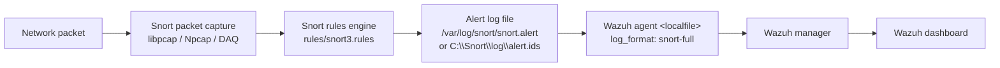

# Architecture Overview

This document describes how **Snort** is installed, configured, and integrated with a
**Wazuh** agent to deliver network-based intrusion detection alongside Wazuh's
host-based security monitoring.

## What the project provides

`wazuh-snort` bundles the resources needed to get Snort running on an endpoint and to
feed its alerts into Wazuh:

- **Installation and configuration scripts** for Linux, macOS, and Windows
  (`scripts/linux/`, `scripts/macos/`, `scripts/windows/`).
- **A Helm chart** (`helm/`) that deploys Snort as a Kubernetes `DaemonSet` so every
  cluster node is monitored.
- **Snort rules** (`rules/snort3.rules` and `rules/sid-msg.map`) used to define the
  signatures Snort inspects traffic against.
- **A Dockerfile** that builds a Snort 3 container image used by the Helm chart.
- **GitHub Actions workflows** that build, package, and test Snort, and publish the
  Helm chart.

## Snort and Wazuh in a nutshell

Snort is a network intrusion detection/prevention system (IDS/IPS) that performs
signature-based detection and protocol analysis on live network traffic. Wazuh is an
open-source security platform that performs host-based monitoring: file integrity,
log analysis, vulnerability detection, and compliance.

By combining the two, the project provides:

- **Network-layer visibility** from Snort (who is talking to whom, known-bad
  signatures, protocol anomalies).
- **Host-layer context** from Wazuh (processes, files, system events) for the same
  endpoint.

## Event flow

The diagram below shows how a packet eventually becomes an alert in the Wazuh
dashboard:

1. **Packet capture** - Snort captures traffic on a network interface using libpcap
   (Linux), Npcap (Windows), or the Snort DAQ layer.
2. **Rule evaluation** - each packet is matched against the loaded Snort rules
   (community rules plus `rules/snort3.rules`). A match generates an alert.
3. **Alert logging** - alerts are written to a log file. On Linux this is
   `/var/log/snort/snort.alert`; on Windows it is `C:\Snort\log\alert.ids`. macOS
   logs to `/var/log/snort` using the `alert_full` format.
4. **Wazuh ingestion** - the Wazuh agent's `ossec.conf` declares a `<localfile>`
   entry pointing at the Snort alert log with `log_format snort-full`. The agent
   tails the file and forwards new events.
5. **Correlation and storage** - the Wazuh manager receives, normalizes, and stores
   the Snort events.
6. **Visualization** - the events are available in the Wazuh dashboard for search
   and alerting.

## NIDS vs. NIPS modes

Snort can run in two fundamental modes:

- **NIDS (Network Intrusion Detection System)** - Snort passively inspects traffic
  and **alerts** on suspicious activity without interrupting the flow. This is the
  default mode configured by the install scripts (alert rules) and by the Helm chart.
- **NIPS (Network Intrusion Prevention System)** - Snort actively **drops** or
  **rejects** matching traffic. This requires placing Snort inline (e.g. `-Q` /
  inline mode with appropriate DAQ) and using `drop`/`reject` rules rather than
  `alert` rules.

The rules shipped in this repository are primarily `alert` rules, so the default
deployment is detection-oriented. To enable prevention, the deployment must be moved
inline and the rule actions changed accordingly. Some rules carry
`metadata:policy max-detect-ips drop` hints that indicate a drop action in IPS
policy mode.

## Deployment modes

### Standalone endpoint

Snort is installed directly on a host via the platform install script (see
[Installation](../operations/installation.md)). The host runs a Wazuh agent that
reads the Snort alert log. This is the standard setup for Ubuntu, macOS, and Windows
endpoints.

### Kubernetes (Helm DaemonSet)

The Helm chart deploys Snort as a **DaemonSet**, so a Snort container runs on
**every node** of the cluster. Because a DaemonSet runs one Pod per node, the chart
gives cluster-wide network monitoring without manually scheduling workloads. Each Pod
captures traffic on its node's interface and writes alerts into a per-node
subdirectory of a shared persistent volume (`/var/log/snort/<node-name>/`). See
[Kubernetes deployment](../operations/kubernetes.md) for details.

The DaemonSet requires elevated privileges (`NET_ADMIN` capability) and mounts the
host's network interface directory (`/sys/class/net`) to discover interfaces.

## Supported operating systems

The install scripts target:

- **Ubuntu** (Debian-based) - via `scripts/linux/install.sh`, installing the Snort
  package from `apt` and configuring `/etc/snort/snort.conf`. This installs the
  system **Snort 2.9.x** package (configured via `snort.conf`).
- **macOS** - via `scripts/macos/install.sh`, installing Snort through Homebrew
  (**Snort 3**, `snort.lua`) and registering a launchd daemon.
- **Windows** - via `scripts/windows/install.ps1`, installing the **Snort 2.9.20**
  installer and Npcap, configuring `snort.conf`, and registering a scheduled task.
- **Kubernetes / Docker** - the Helm chart deploys the container image built from
  the `Dockerfile`, which compiles **Snort 3.2.2.0** (see
  [Building and packaging Snort 3](../development/build-and-package.md)).

> **Version note:** Linux and Windows endpoints get **Snort 2.9.x** (configured via
> `snort.conf`), while macOS, the container image, and the Helm chart use
> **Snort 3** (configured via `snort.lua`). Do not expect Snort 3 Lua configuration
> files on Linux or Windows endpoints.

All platforms require a **Wazuh agent** installed on the endpoint as a prerequisite.

## Related documentation

- [Installation & Setup](../operations/installation.md)
- [Kubernetes deployment](../operations/kubernetes.md)
- [Rules reference](../reference/rules.md)
